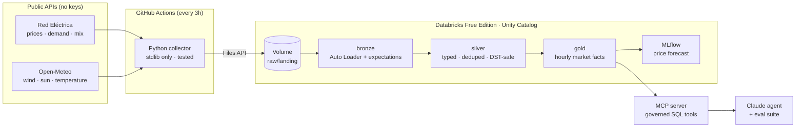

# GridPulse ⚡

**A lakehouse and AI agent for the European electricity market, built on real public data.**

GridPulse collects Spanish grid data (Red Eléctrica de España) and weather for the regions where Spain's wind and solar power is generated. It refines that data in a Databricks lakehouse, forecasts prices, and exposes the curated data to a Claude agent over **MCP**, so anyone can ask *"why did the price go negative on Sunday?"* and get an answer backed by SQL and sources.

> **Why it matters:** in the first two weeks collected (25 Oct – 8 Nov 2026), the Spanish day-ahead price ranged from **−1.46 €/MWh** to **326 €/MWh**. The pattern is plain in the gold table:
>
> | Day | Renewable share | Avg spot price | Hours below zero |
> |---|---|---|---|
> | Sun 25 Oct | 57% | 112 €/MWh | 6 |
> | Sun 1 Nov | 52% | 163 €/MWh | 5 |
> | Thu 5 Nov | 35% | 239 €/MWh | 0 |
> | Fri 6 Nov | 35% | 246 €/MWh | 0 |
>
> Explaining moves like these is what GridPulse is for.



## Design decisions

| Decision | Why |
|---|---|
| Collect **outside** Databricks (GitHub Actions) and upload through the Files API | Free Edition restricts outbound internet. Keeping collection outside Databricks also separates the edge from the platform. |
| Bronze keeps the payload as an **untouched JSON string** | An upstream schema change never breaks ingestion, and every row can be replayed from the exact bytes the API returned. |
| Self-describing **envelope** (source, window, URL, fetched_at) | Audit trail and replay. Overlapping windows are deduplicated in silver by the latest `fetched_at`. |
| Zero runtime dependencies in the collector | It runs anywhere (laptop, CI, a VPS) with plain Python 3.11 or newer. |
| Every timestamp is stored as a **UTC instant**, plus Madrid wall-clock time | 25 Oct 2026 had 25 hours, with 02:00 happening twice. REE sends explicit offsets. Open-Meteo in local time silently dropped the repeated hour, so the collector requests weather in UTC. |
| Overlapping windows, **latest fetch wins** in silver | REE revises recent values. Re-fetching is cheap and makes the pipeline self-healing. |
| `is_forecast` flag on weather | Weather that was still a forecast when collected is kept separate from observed weather. This prevents target leakage when training the price model. |
| Gold columns carry **comments in Unity Catalog** | The agent reads the column meanings from the catalog instead of a hard-coded prompt. |
| `scripts/reconcile.py` recomputes gold numbers in plain Python | An independent check that the Spark logic is right. |
| Only **gold** is exposed to the agent | The LLM can read curated, documented tables and nothing else. Governance is enforced by Unity Catalog grants, not by the prompt. |

## Datasets

| Source | Dataset | Grain | Content |
|---|---|---|---|
| REE | `prices` | 15 min / 1 h | Day-ahead spot price, PVPC tariff (€/MWh) |
| REE | `demand` | 5 min | Real, forecast and scheduled demand (MW) |
| REE | `generation_mix` | day | Generation by technology (MWh) |
| REE | `renewable_share` | day | Renewable vs non-renewable (MWh) |
| Open-Meteo | `hourly_weather` | 1 h | Temperature, 100 m wind, solar radiation, cloud cover in 6 places (Madrid, Barcelona, Sevilla, Badajoz, Zaragoza, A Coruña) |

## Run it locally

```bash
python -m unittest -v
python -m ingestion.run                                        # yesterday + today -> data/landing
python -m ingestion.run --start 2026-10-01 --end 2026-10-31    # backfill
```

## Deploy to Databricks

1. Run [`databricks/setup.sql`](databricks/setup.sql) in the SQL editor. It creates the catalog, the schemas and the landing volume.
2. Create a personal access token. In the GitHub repo, add the secrets `DATABRICKS_HOST` and `DATABRICKS_TOKEN`.
3. Deploy the pipeline with `databricks bundle deploy`. Then set the repo variable `DATABRICKS_PIPELINE_ID` so that each collection triggers it.
4. Run the **ingest** workflow manually once, with a backfill window.

## Lakehouse tables

| Layer | Table | Grain |
|---|---|---|
| bronze | `bronze_ree`, `bronze_open_meteo` | One row per collected file (raw JSON) |
| silver | `silver_ree_series` | Series × timestamp (5 min to 1 day), long format |
| silver | `silver_weather_hourly` | Location × hour |
| gold | `gold_market_hourly` | Hour: price, demand, forecast error, weather |
| gold | `gold_generation_daily` | Day × technology |
| gold | `gold_daily_summary` | Day: prices, negative hours, mix shares, weather |

Validate the pipeline with `python scripts/reconcile.py`. It must match:

```sql
SELECT date_madrid, hours_in_day, round(spot_price_avg_eur_mwh, 2) AS avg_eur,
       spot_price_min_eur_mwh AS min_eur, negative_price_hours, round(renewable_share, 3) AS renewable
FROM gold_daily_summary ORDER BY date_madrid;
```

## Roadmap

- [x] **Phase 1, ingestion and bronze:** tested collector, envelope format, Auto Loader with data-quality expectations, CI schedule
- [x] **Phase 2, silver and gold:** typed series, dedup, DST-safe timestamps, hourly market facts, daily summary, column comments, reconciliation script
- [ ] **Phase 3, forecasting:** next-day price model against a naive baseline, tracked in MLflow
- [ ] **Phase 4, agent:** MCP server with governed SQL tools; Claude answers with citations
- [ ] **Phase 5, evals and reach:** a golden-question eval suite, a public dashboard, more countries via ENTSO-E

## Data sources and licences

- [Red Eléctrica de España, REData API](https://www.ree.es/es/apidatos), open data
- [Open-Meteo](https://open-meteo.com/), CC BY 4.0

Non-commercial portfolio project.
